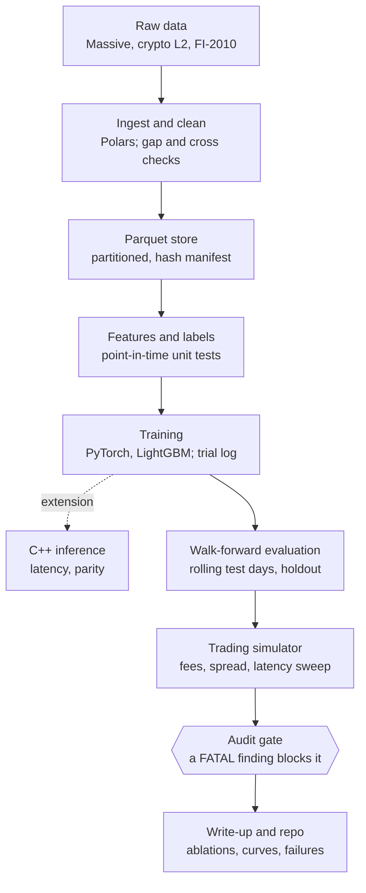

# Ladder: Short-Horizon Price Forecasting from the Limit Order Book

Design doc · Nov 7, 2026 · Yvette Pan

## Summary

Ladder trains deep models to forecast the mid-price direction of liquid US stocks over the next 10 to 100 quote and trade events, then tests whether those forecasts survive a cost-aware trading simulation out of sample.

The core question is narrow: does a deep model trained on raw event sequences beat linear and gradient-boosted baselines on **net P&L**, not just on classification accuracy, under strict walk-forward evaluation? The data pipeline, features, simulator and C++ inference path all exist to make that one comparison trustworthy.

Ladder is a standalone research project. It shares Zen Trading's evaluation discipline (point-in-time data, adversarial audit, paired out-of-sample tests) but none of its data or its daily and weekly strategies.

## Goals, non-goals, and success criteria

The project succeeds if every headline number is reproducible and the deep-vs-baseline comparison holds up under audit, whether or not the deep model wins.

**Goals**

1. Build a reproducible pipeline from raw quote and trade data to labeled training tensors, with point-in-time guarantees enforced by tests.
2. Compare four model families (logistic regression, LightGBM, a DeepLOB-style CNN-LSTM, a small Transformer) under one walk-forward protocol and one tuning budget.
3. Turn predictions into a simple trading policy and report out-of-sample net P&L after fees, spread and latency.
4. Explain where the deep model wins or loses through ablations on inputs, horizon, book depth and normalization.
5. Ship one extension: C++ inference with measured latency, or an RL market-making agent.

**Non-goals**

- No live trading and no real capital.
- No latency arms race: no co-location, kernel bypass or FPGA work.
- No claim of a deployable edge. A well-explained negative result is an acceptable outcome.

**Done means**

- Every reported number regenerates from one command, a pinned config and a data-manifest hash.
- The deep model and the best baseline are compared on the same out-of-sample days, with a paired test, an effect size and a block-bootstrap confidence interval.
- A public repo and a write-up with ablations, training curves and a failure analysis.

## Problem framing

The model sees the last 100 quote and trade events and predicts whether the smoothed mid-price will move up, down or stay flat over the next k events, with k in {10, 20, 50, 100}.

**The data is level 1.** The main dataset is Massive's consolidated NBBO, the single best bid and offer across US exchanges with their sizes, plus every trade and the venue it printed on. There is no depth behind the touch, so a secondary crypto dataset with 10 levels per side measures what depth would add. The mid-price is the average of the best bid and best ask.

**The label.** Following the FI-2010 and DeepLOB convention, compare the mean mid-price over the next k events with the current mid:

```math
\ell_t = \frac{\frac{1}{k}\sum_{i=1}^{k} m_{t+i} - m_t}{m_t},\qquad y_t = \begin{cases} \text{up} & \ell_t > \alpha \\ \text{down} & \ell_t < -\alpha \\ \text{flat} & \text{otherwise} \end{cases}
```

Smoothing over k events keeps bid-ask bounce from dominating the label. The threshold α is set per instrument so the three classes are roughly balanced, and it is computed on the training window only.

**Event time versus clock time.** Models are trained in event time, which normalizes for bursts of activity and keeps results comparable to the literature. The trading simulator runs in clock time, because fills and latency happen in milliseconds, not events. Each event keeps its exchange and SIP timestamps, both in nanoseconds, so the two views stay linked.

**Why a direction label first.** A three-class target is the benchmark convention and is easy to sanity-check. A regression head on the raw forward return is an ablation, used later to size positions.

## Data

Massive's US equities tape is the main dataset: NBBO quotes and every trade back to 2003, which is closer to Virtu's core market than crypto and long enough to test across regimes. A crypto L2 feed is kept for one job only, measuring what depth adds, and FI-2010 stays as the week-one sanity check.

| Source | What it is | Role in Ladder | Limits |
| --- | --- | --- | --- |
| [Massive Stocks Advanced](https://massive.com/knowledge-base/article/how-much-historical-stock-data-does-massive-have) | Consolidated NBBO quotes and every trade across US exchanges, dark pools and TRFs; nanosecond timestamps; from Sept 2003, delisted tickers included | Training, walk-forward evaluation, P&L and regime tests | [Level 1 only](https://massive.com/knowledge-base/article/does-massive-offer-level-2-data): no depth behind the touch, no queue information |
| Crypto L2 | Depth snapshots or diffs for liquid perpetuals, 10 levels per side | The L1-versus-10-level depth ablation | Different fees, tick sizes and participants from equities |
| FI-2010 | Public LOB benchmark: 5 Nasdaq Nordic stocks, 10 trading days, pre-normalized | Reproduce published baseline scores before touching new data | Small, from 2010, no realistic P&L |

**Universe.** About 30 US stocks and ETFs with high quote activity, split between large-tick names, whose spread is usually one cent, and small-tick names with wider spreads. Each name's group comes from its measured spread distribution in the training window. Queue imbalance behaves very differently in the two groups, so every result is reported per group.

**Storage.** Massive's daily [flat files](https://massive.com/docs/flat-files/stocks/quotes) are converted to Parquet with Polars, partitioned by ticker and date. Quotes and trades stay in separate tables and merge into one event stream at feature time. A manifest records a content hash for every partition, and every run logs the manifest hash it read.

**Cleaning rules.**

- Keep regular trading hours only, and drop the first and last 5 minutes around the opening and closing auctions.
- Drop trading halts, and any sample whose label horizon spans a halt or the close.
- Filter trades by condition code, so corrections and out-of-sequence prints never enter features or labels.
- Drop crossed or locked NBBO states and log how many.
- Order events by SIP timestamp, then sequence number. Massive's sequence numbers increase but skip values, so they cannot reveal gaps; flag unusual silences in timestamps instead.

## Features and labels

Three input sets are built from the same event stream, and swapping between them is the main ablation: does a deep model on raw events learn anything the hand-crafted features miss?

| Input set | Contents | Shape per sample |
| --- | --- | --- |
| Raw L1 | Per event: bid and ask distance from the mid in ticks, bid and ask size, event type (quote or trade), trade size and side, time since the previous event; last 100 events | 100 × ~10 |
| Hand-crafted | L1 queue imbalance, microprice minus mid, spread in ticks, order-flow imbalance at the best level over several windows, signed trade imbalance, realized volatility, quote update rate, time since last trade, off-exchange share of recent volume | ~30 features, plus lags for the tree model |
| Combined | Raw L1 sequence plus hand-crafted features as extra channels | 100 × ~40 |
| Raw L10 (crypto only) | Price and size for 10 levels per side, last 100 events | 100 × 40 |

Raw L10 exists only for the depth ablation: on crypto, the same model is trained on L1 and on 10 levels, and the gap shows what the equity setup gives up.

**Trade side.** Each trade is signed buy or sell by comparing its price with the NBBO mid just before it (the Lee-Ready approach), using only quotes stamped strictly earlier than the trade.

**Normalization.** Prices enter as distance from the mid in ticks rather than raw price, which removes most of the non-stationarity. Sizes are log-transformed, then z-scored per ticker with statistics from strictly earlier days. A rolling previous-day z-score versus a fixed training-window z-score is one ablation.

**Point-in-time rules,** each enforced by a unit test:

- Features at event t use only events at or before t.
- Labels use only events after t, and never cross a halt or the close.
- Normalization statistics and the threshold α come from the training window only.
- Equity samples split cleanly at day boundaries. Crypto trades 24/7, so an embargo of 200 events (feature window plus the longest horizon) separates every crypto train, validation and test segment.

## Models

LightGBM on hand-crafted features is the model to beat; the deep models earn their place only if they beat it on net P&L under the same protocol and the same tuning budget.

| Model | Input set | Question it answers |
| --- | --- | --- |
| Logistic regression | Hand-crafted | Is there any linear signal at this horizon? |
| LightGBM | Hand-crafted plus lags | How far do good features and a strong tabular learner go? |
| CNN-LSTM (DeepLOB-style) | Raw L1; Raw L10 on crypto | Does the reference deep architecture still work on L1-only equity data? |
| Small Transformer | Raw L1 and combined | Does attention over the event sequence add anything beyond the CNN-LSTM? |

**Training setup.**

- PyTorch with mixed precision on a single GPU; the models are small enough that distributed training is not needed.
- Cross-entropy with class weights, AdamW, cosine learning-rate schedule.
- Early stopping on a validation slice taken from the end of the training window, never from the test day.
- Three seeds per final configuration, so every result reports seed variance.
- A fixed budget of 20 hyperparameter trials per model family. Every trial is logged, including discarded ones, so the multiple-testing count is known.

**Training dynamics to record.** Loss and macro-F1 curves, calibration, the predicted class mix per day, and gradient norms. The failure to watch for is collapse to the flat class: accuracy looks fine while the model never trades.

## Evaluation protocol

Out-of-sample net P&L on a rolling walk-forward is the primary metric; classification scores are diagnostics only, because a model can post a good F1 and still lose money after costs.

**Walk-forward.** Train on the previous T days, validate on the tail of that window, test on the next day, then roll forward one day. T = 5, 10 and 20 days is one ablation. The final 4 weeks of data are locked as a holdout and evaluated exactly once, at the end of the project.

**Regime stress test.** Because the equity history reaches back to 2003, the same walk-forward protocol also runs over two stress windows, autumn 2008 and March 2020. A model that only works in calm markets is reported as such, not averaged away.

**Metrics.**

| Tier | Metrics | Used for |
| --- | --- | --- |
| Prediction | Macro-F1, Matthews correlation, Brier score, predicted class mix | Debugging and model selection inside the training window |
| Economic | Net P&L, daily Sharpe, P&L per trade in ticks, turnover, max drawdown, break-even cost | The headline comparison |

**Statistics.**

- Compare the deep model and the best baseline on the same test days, using the daily P&L difference.
- Daily P&L is autocorrelated and fat-tailed, so confidence intervals come from a block bootstrap, not a t-test.
- Report the effect size beside every p-value.
- Adjust for the number of configurations tried, using the trial log from the Models section.

**Audit gate.** Before any number enters the write-up, run the adversarial audit checklist against it: lookahead, multiple testing, cost and capacity, regime dependence, fragility with the top 5 trades removed, and implementation traps. A FATAL finding blocks the number.

## Trading simulation

The simulator starts with the harshest realistic policy, crossing the spread as a taker, because most short-horizon signals die there and knowing exactly where they die is itself a result.

**Policy 1: taker (required).** When the predicted probability of up exceeds a threshold θ, buy 100 shares at the ask; down, sell at the bid. Exit after k events or on an opposite signal. Position is capped at 100 shares, so results measure signal quality, not sizing. θ is chosen on the validation slice only.

**Policy 2: passive quoting (optional).** Quote on both sides and skew the quotes toward the predicted direction. A resting order fills only when the market trades through its price, never when it merely touches it. This conservative rule stands in for queue-position modeling, which Ladder does not attempt. The NBBO shows no queue and pools size across venues, so passive results stay secondary to the taker results.

**Cost model.**

| Component | How it is modeled |
| --- | --- |
| Spread | Paid in full on every taker fill, taken from the book at execution time |
| Fees | Equities: exchange access fees for taking liquidity, plus SEC and FINRA fees on sells. Crypto ablation: the venue's published taker rate |
| Latency | Orders execute against the NBBO L milliseconds after the signal's SIP timestamp; L is swept over 1, 10 and 100 ms |
| Slippage | Depth behind the touch is unknown, so an order larger than the displayed NBBO size is skipped, not filled |

**Break-even cost.** For every model, report the fee level at which net P&L reaches zero. This one number shows how far a signal is from tradable, and it stays meaningful even when every model loses money at real fees.

## Extensions

Build the C++ inference path first: it takes about two weeks, has a deterministic definition of done, and answers the C++ and low-latency questions directly. The RL agent comes only if time remains.

**A. C++ low-latency inference.**

- Export the best deep model through TorchScript or ONNX and run it with LibTorch or ONNX Runtime, single thread, batch size 1.
- Reimplement feature computation incrementally in C++: a ring buffer holds the last 100 events, and each book update changes only what it touches.
- Port the LightGBM and logistic models too, so the latency table compares like with like.
- Report p50, p99 and max latency per event for the Python and C++ paths.
- A parity test on a held-out day checks the maximum absolute difference between Python and C++ logits, and fails the build above a set tolerance.

**B. RL market-making agent.**

- Environment: historical book replay with the conservative fill rule from Policy 2.
- Baseline: Avellaneda-Stoikov quoting with an inventory penalty.
- Agent: PPO choosing quote offsets and skew from book state, the Ladder forecast and current inventory.
- Reward: P&L minus an inventory penalty, evaluated on out-of-sample days against the baseline.
- Known limit: replay ignores the market impact of the agent's own orders, so results are an upper bound.

## System architecture

Ladder is one Python package plus a separate C++ inference directory, and every run can be rebuilt from four logged values: git commit, config hash, data-manifest hash and seed.



Data moves top to bottom. The C++ path branches off training as an optional extension, and no result reaches the write-up without passing the audit gate.

**Repo layout.**

```text
ladder/
├── data/       ingest, cleaning, Parquet writer, manifest
├── features/   raw tensors, hand-crafted features, labels
├── models/     logistic, lightgbm, cnn_lstm, transformer
├── train/      training loop, tuning budget, trial log
├── eval/       walk-forward splitter, metrics, bootstrap tests
├── sim/        taker and passive policies, cost model
├── audit/      adversarial checklist runner
├── cpp/        LibTorch or ONNX Runtime inference, ring buffer, parity test
├── configs/    one YAML file per experiment
├── tests/      point-in-time and leakage tests
└── reports/    generated figures and tables only
```

**Reproducibility rules.**

- Experiment tracking in MLflow or Weights & Biases: each run logs commit, config hash, manifest hash, seed, metrics and artifacts.
- One command regenerates every figure and table from logged runs. No figure is edited by hand.
- CI runs the point-in-time tests and the C++ parity test on every push.

## Milestones

The plan runs 8 weeks with three gates, and the deep models start only once the baselines, the walk-forward harness and the simulator run end to end.

| Weeks | Phase | Gate to pass |
| --- | --- | --- |
| W1–W2 | Data and FI-2010 check | Point-in-time tests pass |
| W3 | Baselines and simulator | One command runs it all end to end |
| W4–W5 | Deep models: CNN-LSTM, Transformer, tuning | No gate |
| W6 | Ablations and audit | No FATAL audit finding |
| W7 | C++ inference (Extension A) | No gate |
| W8 | Holdout and write-up | Holdout opened exactly once |

Weeks are relative to the start date, which is still open. If week 2 cannot reproduce the FI-2010 baseline scores, fix the pipeline before going further, because every later number depends on it.

## Risks and open questions

The most likely outcome is that no model clears taker costs at any horizon; the project is designed so that this result is still worth publishing.

| Risk | Mitigation |
| --- | --- |
| No edge after costs | Report break-even cost per model and the passive-quoting result; explain where the signal decays |
| No depth in the main dataset | Measure what depth adds with the L1-versus-10-level ablation on crypto |
| SIP timing and consolidated quotes | Measure latency from the SIP timestamp and sweep it conservatively; taker results are the headline |
| Millions of quote updates per stock per day | Polars lazy scans with partition pruning; a Numba or C++ core for the event-loop simulator |
| Overfitting through repeated peeking | Locked 4-week holdout, fixed tuning budget, full trial log |
| Data gaps and bad prints | Condition-code filters, timestamp-gap flags, counts reported |
| Deep model collapses to the flat class | Class weights, macro-F1 monitoring, per-day class mix in every run report |

**Open questions to verify before starting.** The Massive details come from its documentation; everything else here is from memory and unchecked.

- [ ] Massive: confirm the plan is Stocks Advanced with flat-file access, and settle which trade and quote condition codes to exclude
- [ ] Fees: current US exchange access fees and SEC and FINRA fee rates; the crypto venue's taker rate for the ablation
- [ ] FI-2010: current download location, license, and the published baseline scores to reproduce
- [ ] Crypto L2: which source gives full-depth snapshots or diffs for free, and for how many days
- [ ] References: DeepLOB (Zhang, Zohren and Roberts, 2019); FI-2010 (Ntakaris et al., 2018); Avellaneda and Stoikov (2008), on limit order book market making; Cont, Kukanov and Stoikov (2014), on order-flow imbalance; Lee and Ready (1991), on trade classification
